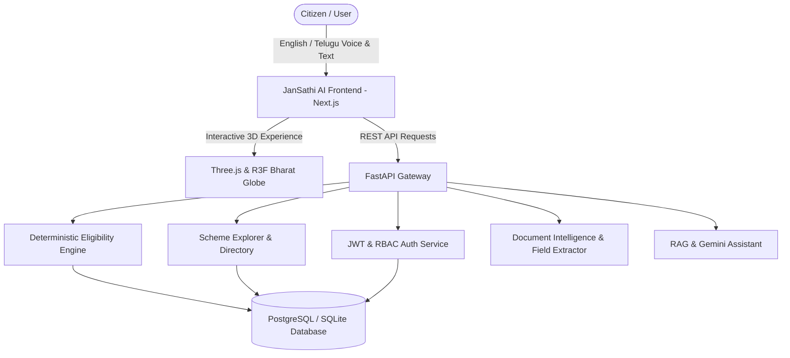

# BharatSahayak AI / JanSathi AI 🇮🇳
### *Government Services Made Simple for Every Indian*

[](https://nextjs.org/)
[](https://fastapi.tiangolo.com/)
[](https://docs.pmnd.rs/react-three-fiber)
[](https://python.org)
[](https://tailwindcss.com/)
[](LICENSE)

An AI-powered multilingual government services platform designed for Indian citizens. The platform democratizes access to public welfare by helping citizens discover schemes, verify deterministic eligibility requirements, prepare documents with OCR, and access step-by-step application guidance in **Telugu (తెలుగు)** and **English**.

---

## 🌟 Key Platform Features

### 1. 🇮🇳 Indian Digital Public Infrastructure (DPI) Inspired UI
- **3D Animated Hero Section:** Interactive Three.js/React Three Fiber 3D globe representing India with coordinate-accurate beacon markers, orbital rings, and floating holographic welfare cards.
- **Glassmorphism Design:** Styled with Indian tricolor accents (Saffron, Navy Blue, and Subtle Emerald Green).
- **Accessible Fallback:** Seamless 2D CSS/SVG fallback for non-WebGL devices and reduced-motion preferences.

### 2. 🗣️ Native Bilingual Support (English & Telugu)
- Full reactive language switcher covering all landing copy, scheme criteria, application steps, and FAQs.
- Native Telugu (`తెలుగు`) and English text and conversational assistant.

### 3. 🔍 Smart Government Scheme Explorer
- Central & State welfare initiatives categorized under Agriculture, Healthcare, Housing, Financial Inclusion, Women & Child Development, Education, and MSME.
- Multi-filter search (by keyword, category, jurisdiction: Central/State).
- Sorting by popularity, verification date, and name (A-Z).
- In-depth detail pages containing benefits breakdown, mandatory criteria, prerequisite certificates, and direct links to official government portals (`pmkisan.gov.in`, `pmjay.gov.in`, etc.).

### 4. ⚖️ Scheme Comparison Engine
- Compare up to 3 government schemes side-by-side.
- Compares financial benefits, eligibility rules, required documents, and official application portals.

### 5. 🎯 Deterministic Rule-Based Eligibility Engine
- Rule matching against structured scheme parameters (age, land holding, income limits, occupation).
- Zero hallucination guarantee: AI is used to explain results, not to invent eligibility approvals.

### 6. 👤 Citizen Dashboard & Personalization
- Personalized dashboard with tailored recommendations matching user profile (Farmer, Student, Small Business Owner, etc.).
- Scheme bookmarks with instant save/unsave toggling.
- Document readiness score tracker and application progress monitors.

---

## 🏗️ Technical Architecture



---

## 🚀 Quick Start Guide

### Prerequisites
- **Node.js** v18+ or v20+
- **Python** 3.10+ or 3.12+

### 1. Clone the Repository
```bash
git clone https://github.com/reddycharankumar513-dotcom/BharatSahayak-AI-Powered-Government-Scheme-Assistant.git
cd BharatSahayak-AI-Powered-Government-Scheme-Assistant
```

### 2. Backend Setup
```bash
# Navigate to backend and install dependencies
pip install -r backend/requirements.txt

# Run the database seeder (populates verified categories, schemes, and demo accounts)
python -m backend.app.database.seed

# Start the FastAPI backend server
python -m uvicorn backend.app.main:app --host 0.0.0.0 --port 8000
```
Backend API will be running at `http://localhost:8000`  
Interactive Swagger docs: `http://localhost:8000/docs`

### 3. Frontend Setup
```bash
# In another terminal, navigate to frontend
cd frontend

# Install npm dependencies
npm install

# Start Next.js development server
npm run dev
```
Web application will be live at `http://localhost:3000`

---

## 🔑 Demo Accounts for Evaluation

| Role | Email | Password | Details |
|---|---|---|---|
| **Citizen Demo** | `citizen@jansathi.gov.in` | `JanSathiDemo2026!` | Smallholder Farmer, Andhra Pradesh |
| **Admin Officer** | `admin@jansathi.gov.in` | `AdminJanSathi2026!` | Nodal Officer, Telugu language preference |

*Tip: On the Login page (`/auth/login`), use the one-click "Citizen Demo" or "Admin Officer" buttons to pre-fill credentials instantly.*

---

## 📁 Repository Structure

```
.
├── frontend/
│   ├── app/                  # Next.js App Router (Landing, Auth, Dashboard, Schemes, Comparison)
│   ├── components/
│   │   ├── three/            # Three.js 3D India Globe & Accessible Fallback
│   │   └── ui/               # Navbar, Hero, Schemes, HowItWorks, FAQ, Footer
│   ├── lib/                  # Language context (Telugu & English) & Auth context
│   ├── services/             # API client
│   └── package.json
│
├── backend/
│   ├── app/
│   │   ├── api/              # Auth, Schemes, Dashboard routers
│   │   ├── core/             # Configuration & Bcrypt/JWT security
│   │   ├── database/         # Session, Base, and Seeder
│   │   ├── models/           # 13 SQLAlchemy models
│   │   ├── schemas/          # Pydantic v2 schemas
│   │   └── main.py           # FastAPI entry point
│   └── requirements.txt
│
├── docs/
│   ├── ARCHITECTURE.md       # Detailed technical design & RAG specifications
│   ├── PHASE1_COMPLETION.md  # Phase 1 verification log
│   └── PHASE2_COMPLETION.md  # Phase 2 verification log
│
├── docker-compose.yml        # Docker compose configuration
├── .env.example              # Environment variables template
├── .gitignore
└── README.md
```

---

## 🛡️ Trust & Security Guardrails
- **No Sensitive Credential Requests:** We never ask for Aadhaar OTPs, passwords, or bank PINs.
- **Verified Official Sources:** All scheme application procedures redirect exclusively to verified government domains (`data.gov.in`, `india.gov.in`, `pmkisan.gov.in`, `pmjay.gov.in`).
- **Grounded Verification:** Every AI response is cross-checked against official Gazette notifications.

---

## 📄 License
This project is licensed under the MIT License. Built with pride for Bharat 🇮🇳.
