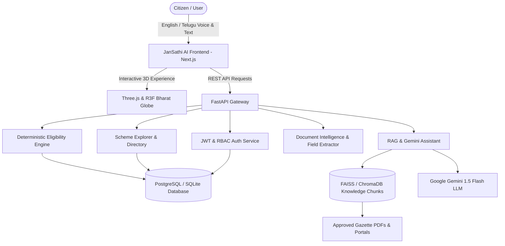

# JanSathi AI - Architecture & Technical Specification

> **Tagline:** "Government Services Made Simple for Every Indian."
> **Mission:** Make government services understandable, accessible, and easier to navigate for every Indian citizen through grounded AI, deterministic eligibility checks, and multilingual voice assistance.

---

## 1. System Overview

JanSathi AI is a full-stack civic technology web platform designed for India's 1.4 billion citizens. It combines:
1. **Interactive 3D Public Experience:** WebGL/Three.js-powered visual identity inspired by Indian Digital Public Infrastructure.
2. **Grounded Multilingual AI Assistant:** Built on Google Gemini 1.5 Flash and RAG over official government gazettes and ministry portals.
3. **Deterministic Eligibility Engine:** Rule-based matching engine guaranteeing zero hallucinations in eligibility decisions.
4. **Smart Document Intelligence & OCR:** Local processing pipeline checking document readiness against scheme prerequisites before application.
5. **Civic Trust & Auditing:** Transparent source citations, last verified timestamps, and administrative audit logging.

---

## 2. Technology Stack

| Layer | Technologies | Purpose |
|---|---|---|
| **Frontend** | Next.js 14, React 18, TypeScript, Tailwind CSS | High-performance, SEO-friendly, responsive civic interface |
| **3D & Motion** | Three.js, React Three Fiber, Drei, Framer Motion | Engaging 3D India globe, floating cards, accessible fallbacks |
| **Icons & UI** | Lucide React, Glassmorphism CSS | Consistent iconography and clean Indian DPI aesthetic |
| **Backend API** | Python 3.12, FastAPI, Pydantic v2, Uvicorn | High-throughput asynchronous REST API |
| **Database & ORM**| PostgreSQL 15, SQLAlchemy 2.0 | Relational storage for schemes, users, and audit logs |
| **AI & RAG** | Google Gemini API, NumPy/FAISS | Grounded semantic retrieval and bilingual query resolution |
| **OCR & Vision** | PyPDF, Pillow, EasyOCR / Tesseract | Document field extraction and checklist matching |
| **Authentication**| JWT (python-jose), Passlib (Bcrypt) | Secure citizen registration, profiles, and admin RBAC |

---

## 3. Bilingual Support: English & Telugu (తెలుగు)

Every citizen-facing surface in JanSathi AI is built with first-class support for English and Telugu:
- **Full UI Translations:** Headings, descriptions, badges, buttons, scheme summaries, benefits, and steps.
- **Telugu Voice Synthesis & Recognition:** Voice-guided interactions tailored for rural citizens who prefer conversational speech over typing.
- **Scheme Metadata:** Bilingual titles, eligibility descriptions, and document requirements stored natively in the schema.

---

## 4. Grounded AI & Anti-Hallucination Guardrails

1. **Deterministic Eligibility Rules:** Structured eligibility checks are strictly evaluated via mathematical and logical conditions (e.g., `age >= 18`, `land_holding > 0`, `annual_income <= 250000`). AI is used solely to explain the deterministic output, never to fabricate approvals.
2. **Mandatory Citations:** Every AI answer must cite the verified government source URL and gazette notification.
3. **Safe Fallbacks:** If an external Gemini API key is not present, a safe grounded local fallback mechanism responds accurately using the verified database knowledge chunks without failing.
4. **Data Privacy Guardrails:** No real Aadhaar OTPs, passwords, or bank PINs are ever collected or stored.
